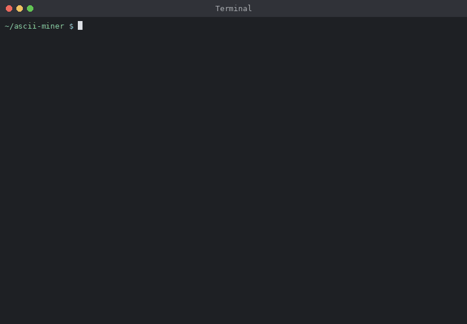

# Miner — 多人 ASCII 挖礦遊戲

網路系統開發期中作業：以 C 撰寫的 client–server 終端機遊戲。server 用 `fork()` 為每個連線建立
child process，世界狀態放在跨行程共享記憶體中。

- 協定規格：[docs/protocol.md](docs/protocol.md)

## Gameplay



Walk around the shared map and dig. Every cell can be dug only once.

## 建置

```bash
make            # release → build/{libminer.so,miner_server,miner_client}
make DEBUG=1    # 編入 debug log → build-debug/
make test       # 單元測試
make e2e        # 端到端測試：並行 + 5 組強健性 demo（約 1 分鐘）
```

需求：gcc、GNU make、Linux。`capture.sh` 需要 tcpdump 與 sudo，`mgp_stats.py` 需要 python3。

## 遊玩

```bash
build/miner_server                          # 預設 port 5555，地圖 120x40
build/miner_client -n alice                 # 另開終端機
build/miner_client --bot -c 50 -d 60        # 加入 50 個機器人一起挖
```

| 按鍵 | 動作 |
|------|------|
| `W A S D` / 方向鍵 | 移動 |
| `空白` | 挖掘腳下的格子 |
| `i` | 背包（各礦物數量、總價值） |
| `y` | server 系統資訊 |
| `c` | 關閉資訊面板 |
| `q` | 離開 |

畫面符號：`@` 自己、`P` 其他玩家、`#` 未挖、`.` 已挖。

礦物機率與價值：

| 結果 | 機率 | 價值 |
|------|------|------|
| 空 | 85% | 0 |
| 銅 | 10% | 5 |
| 銀 | 3.5% | 15 |
| 金 | 1.2% | 50 |
| 鑽石 | 0.3% | 200 |

## 常用參數

**server**

| 參數 | 說明 |
|------|------|
| `-p` | port |
| `-W` / `-H` | 地圖大小 |
| `-s` | 亂數種子 |
| `-m` | 人數上限 |
| `-q` | 不印每秒狀態 |
| `-v` / `--log-level` | log 等級 |
| `--no-lock` `--no-reap` `--naive-recv` `--no-timeout` `--no-robust` | 關閉各強健性機制 |
| `--idle-timeout S` | 閒置逾時秒數 |
| `--dig-delay-us N` | 模擬挖掘耗時（測試用） |
| `--crash-at-dig N` | 第 N 次挖掘時讓 child 持鎖死亡（測試用） |

**client**

| 參數 | 說明 |
|------|------|
| `-s HOST` / `-p PORT` | server 位址 |
| `-n NAME` | 玩家名稱 |
| `--bot` | 機器人模式 |
| `-c N` | 機器人數量 |
| `-d SEC` | 執行秒數 |
| `-i MS` | 每個機器人的動作間隔 |
| `--fragment-us N` | 逐 byte 送出（測試 partial recv） |
| `--log-file PATH` | log 檔（互動模式預設寫入 `miner_client.log`） |

server 每秒輸出一行狀態：

```
[stat] up=3s online=200 children=200 req/s=1996 err=0 cells=1596/4800 mined=3415/9515 dup=0(+0) lockfix=0 timeout=0 rejected=0
```

| 欄位 | 意義 |
|------|------|
| `online` | 在線玩家 |
| `children` | 尚未回收的 child 數 |
| `cells` | 已挖格數／總格數 |
| `mined` | 已挖出價值／地圖原始總價值 |
| `dup` | 重複取得次數（括號內為重複價值） |
| `lockfix` | robust mutex 復原次數 |

## 展示腳本

| 腳本 | 內容 |
|------|------|
| `scripts/stress.sh [N] [SEC]` | 並行證明（預設 200 個 client），結果存到 `logs/stress_proof.txt` |
| `scripts/capture.sh [normal\|fragment]` | tcpdump 擷取 loopback 並解碼 MGP 封包 |
| `scripts/demo_log.sh` | 兩層 debug log |
| `scripts/demo_lock.sh` | 有／無挖掘鎖：礦物複製 |
| `scripts/demo_reap.sh` | 有／無回收 child：殭屍行程 |
| `scripts/demo_partial.sh` | 有／無串流重組：逐 byte 送出的封包 |
| `scripts/demo_timeout.sh` | 有／無閒置逾時：被凍結的 client |
| `scripts/demo_robust.sh` | 有／無 robust mutex：持鎖者死亡 |
